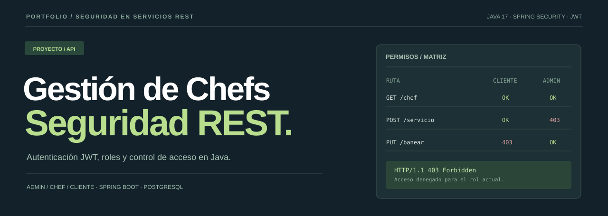

# Gestión de Chefs · Seguridad REST
**Autenticación JWT, autorización por roles y gestión de servicios culinarios.**

[**Explorar el laboratorio**](https://juanjogamero.github.io/API-GESTION-CHEFS-SEGURIDAD/) · [**Ver backend Java**](ProyectoBaseConSeguridad/proyecto/src/main/java/proyecto) · [**Guía de seguridad**](Documentacion/SEGURIDAD.md)

---

## Seguridad que se puede explorar

Una API REST desarrollada como proyecto académico de **Seguridad en Aplicaciones Distribuidas y Servicios en Red**. Gestiona cuentas de chefs, clientes, administradores y servicios gastronómicos.

La interfaz permite **cambiar de rol, consultar permisos, seleccionar endpoints y simular el resultado HTTP**. También permite probar cómo cambia el acceso con una cuenta baneada o un token caducado.

> **La demo de GitHub Pages es un simulador educativo independiente**. No valida JWT reales, no ejecuta peticiones al backend y no utiliza PostgreSQL. Los resultados son ejemplos de las reglas implementadas en Java.

## Backend

- **JWT + Spring Security:** tokens firmados, caducidad y secretos externos al código.
- **Roles:** ADMIN, CHEF y CLIENTE, con rutas públicas y privadas.
- **Cuentas:** contraseñas protegidas con BCrypt, bloqueo y revisión del estado actual del usuario.
- **Servicios:** contratación de chefs activos y bloqueo de reservas duplicadas en una misma fecha.
- **Valoraciones:** de 1 a 5, por el cliente propietario y una sola vez después de la fecha.
- **Privacidad:** anonimización de datos en la desactivación de cuentas.
- **Calidad:** Swagger, JUnit y GitHub Actions.

| Backend | Tecnología |
| --- | --- |
| Lenguaje | Java 17 |
| API | Spring Boot 3.5.5 |
| Seguridad | Spring Security + JWT HS256 |
| Almacenamiento | PostgreSQL, Spring Data JPA |
| Contraseñas | BCrypt |
| Pruebas | JUnit, Mockito, H2 |
| Demostración web | HTML, CSS, JavaScript y GitHub Pages |

## Arrancar el backend localmente

Necesitas **Java 17** y **Docker**. Desde la raíz del repositorio:

**macOS o Linux**

~~~bash
docker compose up -d
cd ProyectoBaseConSeguridad/proyecto
export JWT_SECRET="$(openssl rand -base64 48)"
bash ./mvnw spring-boot:run
~~~

**Windows PowerShell**

~~~powershell
docker compose up -d
cd ProyectoBaseConSeguridad/proyecto
$env:JWT_SECRET = [Convert]::ToBase64String([Security.Cryptography.RandomNumberGenerator]::GetBytes(48))
.\mvnw.cmd spring-boot:run
~~~

Abre **[Swagger UI](http://localhost:8080/swagger-ui.html)**. La clave JWT es obligatoria; no existe ninguna clave real en el repositorio.

Para crear el primer administrador en local, establece APP_ADMIN_USER y APP_ADMIN_PASSWORD (mínimo 12 caracteres) antes de arrancar el servidor.

### Ejemplo: registrar un cliente

**POST /cliente**

~~~json
{
  "username": "cliente_ejemplo",
  "password": "UnaClaveDePruebaSegura",
  "nombre": "Ana",
  "primerApellido": "García",
  "email": "ana@example.com",
  "direccionPostal": "Calle de ejemplo 10"
}
~~~

Después usa **POST /login** con el nombre de usuario y contraseña para recibir un JWT. En Swagger, introdúcelo en **Authorize → Bearer** para explorar rutas privadas.

Pruebas: desde ProyectoBaseConSeguridad/proyecto ejecuta **bash ./mvnw verify**.

## Estructura

~~~text
ProyectoBaseConSeguridad/proyecto/
  src/main/java/proyecto/
    controller/    Endpoints REST
    service/       Reglas de negocio
    respository/   Repositorios JPA (nombre original)
    security/      JWT y configuración de permisos
    entity/        Usuarios y servicios
  src/test/        Pruebas de seguridad y negocio
docs/              Laboratorio de seguridad para GitHub Pages
Documentacion/     Arquitectura y reglas de acceso
~~~

El proyecto original incluía un enunciado de simulacro de la **UD2** que se conserva en el repositorio.

**Alcance:** trabajo académico para el portfolio, no una plataforma de contratación operativa ni una certificación de cumplimiento del RGPD. Las entidades y el formato de roles han evolucionado: si dispones de datos anteriores, haz una copia de seguridad y planifica la migración antes de actualizar.

---

**[Abrir ChefAccess · Laboratorio de seguridad](https://juanjogamero.github.io/API-GESTION-CHEFS-SEGURIDAD/)**

Java · Spring Boot · Spring Security · PostgreSQL

